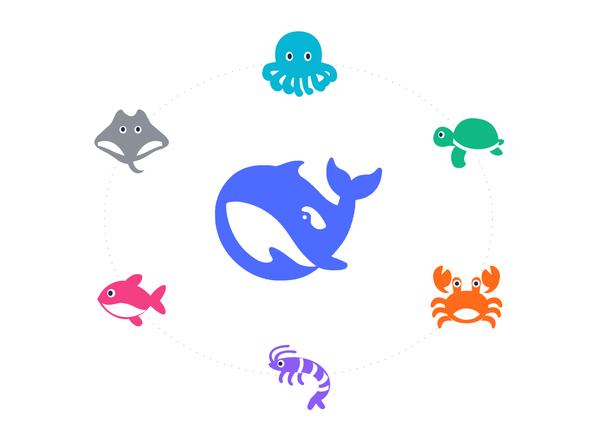

<p align="center">
  <picture>
    <source media="(prefers-color-scheme: dark)" srcset="docs/images/team-orbit-dark.svg">
    
  </picture>
</p>

<h1 align="center">海底小队（Ocean Crew）</h1>

<p align="center">一群各有所长的海洋伙伴，帮你一起把事情做好。</p>

<p align="center">
  
  
</p>

> **个人项目。** 本仓库（[9Ashwin/ocean-crew](https://github.com/9Ashwin/ocean-crew)）是个人学习与日常娱乐用的 Bot 项目，从本仓库安装和构建。不提供商业支持。插件在 DSH 里的包名是 `ocean-crew`。

**海底小队（Ocean Crew）** 是 [DeepSeek Harness](https://github.com/deepseek-ai/deepseek-harness)（DSH）上的 Bot 团队：你创建自己的海洋伙伴 Bot，然后和它们对话、一起干活。

## 是什么

每个 Bot 是一个长期身份，它的工作跑在 DSH Session 里：自己的聊天一条，每个群各一条，上下文满了换新的一条。Bot 之间可以互发消息、在群里协作、把活交给别的 Bot。每个 Bot 有自己的名字、角色、指令、模型和工作文件夹，也有自己的海洋形象。会话和 IM 界面归 Ocean Crew；agent 循环、工具和模型归 DSH。

本仓库只维护一种形态：装进 **DSH Desktop** 里运行的 `ocean-crew` 插件。仓库不提供 Web 部署、Docker 镜像、移动端或自带的桌面应用。

## 安装

先装好 DSH Desktop 并配置至少一个模型。Ocean Crew 使用 DSH 里的模型。

侧栏选择 **Plugins** → **Add plugin**，在 **Package name or address** 里填入：

```text
github:9Ashwin/ocean-crew#main&path:/ocean-crew
```

（需要本机装 Git。）点 **Install**、**Enable now**；如果 DSH 提示改动下次启动生效，完全退出 DSH
再打开。插件不提交构建产物，安装时由 `prepare` 脚本现场构建 `dist/` 和 `client.js`。pnpm 默认会
拦截依赖的构建脚本：遇到提示时允许 `ocean-crew` 的构建（DSH 的 Plugins 页面会给出确认，或在
profile 的 `pnpm-workspace.yaml` 中加 `allowBuilds`，或在本机 profile 的 `pnpm-workspace.yaml` 里加 `dangerouslyAllowAllBuilds: true`）。

### 从本机检出安装（开发用）

开发时也可以构建本仓库，再用 `ocean-crew/dev/install-local.mjs` 把这份 checkout 复制进本机
DSH Desktop 的 profile：

```sh
git clone https://github.com/9Ashwin/ocean-crew.git
cd ocean-crew                          # 仓库根
npm install
npm run build                          # 生成 ocean-crew/dist/ 和 ocean-crew/client.js
cd ocean-crew                          # 插件目录
node dev/install-local.mjs --dry-run   # 只看计划
node dev/install-local.mjs             # 安装并让 DSH 重新加载
```

脚本会先备份已安装的副本；profile 里还没有 `ocean-crew` 目录时会直接新建；`--no-reload` 跳过重新加载，`--profile <dir>` 指定别的 profile。client 侧改动重新加载后生效，host 侧改动需要重启 DSH。

## 快速开始

打开 Ocean Crew，和主 Bot（Chief）说话。它会带你完成设置；Bot、群聊、能力和连接器也都可以通过和它对话来创建和修改。模型用 DSH 里已经配置好的。

## 里面有什么

- **Bot 团队。** 与长期身份的私聊，每个 Bot 有模型、指令、工作文件夹、权限预设、记忆和形象。主 Bot（Main Bot）管理其他 Bot；Bot 之间可以互相交付工作。
- **群聊。** 多个 Bot 一起干活，可以管理员先答再叫人，也可以成员按顺序发言；被 `@` 的成员并行开始。群可以跑分阶段目标和证据核对，每个群有自己的记忆。
- **长聊天、记忆与目标。** 上下文管家在检查线处压缩或换新分段，更早的对话可在全文索引里搜索；每个 Bot、每个群和团队各有一份记忆，可以按范围彻底忘记（留下不含正文的墓碑，之后无法重新写入或被恢复）；群目标按阶段验收，定时任务按计划触发。
- **能力与连接器。** 在设置里共享 MCP server、skill 和 pack；用 OAuth 或密钥连接 GitHub、邮箱和远程 MCP server，凭据留在 Secrets。
- **浏览器。** 插件不内置浏览器；需要时 Bot 用本机已安装的 Playwright CLI 加 Chrome，通过自己的 shell 工具操作页面。
- **IM。** 把 Bot 接到飞书或微信私聊：配对、审批卡和回复都在那里完成，不需要公网地址、不开端口。
- **网页搜索。** 由 DSH 的搜索 provider 提供，在 DSH 设置里配置。
- **用量与外观。** 设置里的 Usage 显示团队与每个 Bot、每个群聊的 token 用量，数字来自 DSH 的 token-meter；12 个海洋形象、13 种颜色，团队主题、强调色、消息布局和动画三档可调。
- **重新开始。** 设置里可以重新初始化团队：清空 Bot、群聊、记忆、学习、日程与 IM 配对，留下密钥和团队工作区，重建一个 Chief 主 Bot，并先把旧数据备份到磁盘。

插件自身的文档见 [`ocean-crew/README.md`](ocean-crew/README.md)。

## 仓库结构

```text
ocean-crew/            插件（TypeScript 实现）
  src/host/            host 半边：跑在 DSH 的 Node 进程里
  src/client/          client 半边：DSH Desktop 里的界面
  src/shared/          host 与 client 共用的契约
  test/                单元测试与集成测试
  dev/                 本地安装、冒烟与构建检查脚本（不发布）
  client.js            client 构建产物（npm run build 生成，git 忽略）
  dist/                host 构建产物（npm run build 生成，git 忽略）
assets/marine/         海洋形象资产：12 个形象、13 色、渲染器与说明
docs/                  架构、契约、界面规范与已知问题
scripts/               仓库工具（泄漏扫描）
```

## 数据

数据都在你自己的电脑上，在 DSH home 目录（`$DSH_HOME`，默认 `~/.dsh`）：团队在 `bot/`，会话在 `sessions/`。卸载插件不会删除这些数据。

## 开发

```sh
cd ocean-crew
npm install
npm run build          # dist/ + client.js
npm test
node dev/check-bundle.mjs
```

改完在仓库根跑完整门禁：

```sh
npm run check
```

`client.js` 和 `dist/` 都由构建生成，不进 git，禁止手改；安装前必须先构建。测试从本机 DSH 安装或 DSH 检出解析 `@deepseek-ai/*`；IM 改动还要在 DSH Desktop 里做一次真实飞书或微信往返。

CI（`.github/workflows/test.yml`）在 push 到 `main` 时运行类型检查、Biome、单元测试、构建产物检查和泄漏扫描。

- 插件文档：[ocean-crew/README.md](ocean-crew/README.md)
- 开发指南：[CONTRIBUTING.md](CONTRIBUTING.md)
- 工作规则：[AGENTS.md](AGENTS.md)
- 架构与术语：[docs/architecture.md](docs/architecture.md)
- 公开契约：[docs/contracts.md](docs/contracts.md)
- 界面规范：[docs/design/ui-standard.md](docs/design/ui-standard.md)
- 已知问题：[docs/known-issues.md](docs/known-issues.md)
- 任务记录：本机 `tasks/<task>/`（`prd.md`、`progress.md`、`checkpoint.md`），不进 git
- 版本变化：[CHANGELOG.md](CHANGELOG.md)

## 许可

[MIT License](LICENSE)，按「原样」提供，不附带任何担保。第三方代码及其许可归属见 [THIRD_PARTY_NOTICES.md](THIRD_PARTY_NOTICES.md)。
